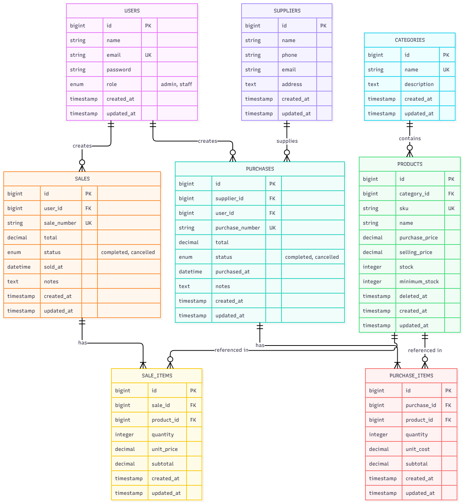
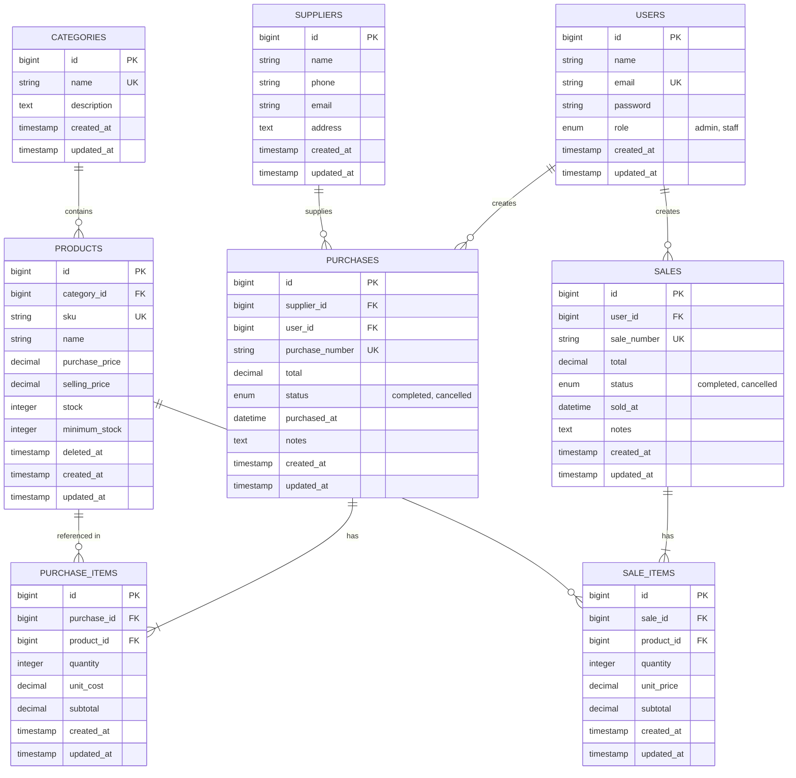

# Inventory & Sales Management System (UTS Web Programming 2)

Aplikasi Web Terintegrasi Manajemen Inventaris dan Penjualan Barang berbasis **Laravel MVC**, **MySQL**, **Eloquent ORM**, **Role-Based Access Control (RBAC)**, dan **Transaksi Database Atomik**.

---

## 1. Project Overview & Business Scenario
Aplikasi ini dikembangkan untuk memecahkan kendala pada usaha distribusi dan ritel skala kecil, seperti ketidakkonsistenan stok akibat pencatatan manual, penjualan produk yang stoknya habis (*overselling*), pencatatan transaksi multi-item, serta pemisahan wewenang antara Admin (Owner) dan Staff (Kasir/Gudang).

### Fitur Utama:
1. **Autentikasi & RBAC Server-Side:**
   * Proteksi level route & controller menggunakan custom middleware `role:admin` dan `role:staff`, serta Gates (`AuthServiceProvider`).
2. **Master Data & Relasi:**
   * Manajemen Kategori, Produk (dengan SKU unik dan status stok), serta Pemasok (Suppliers).
   * Eager loading (`with()`) untuk mencegah query $N+1$.
   * Proteksi hapus data (*soft delete* atau larangan hapus jika memiliki riwayat transaksi).
3. **Transaksi Pembelian (Stock-In):**
   * Pengadaan stok multi-item dari pemasok.
   * Penambahan stok produk secara otomatis dan kalkulasi subtotal/total di sisi server.
4. **Transaksi Penjualan (Stock-Out) Anti-Overselling:**
   * Transaksi atomik dibungkus `DB::transaction`.
   * Perlindungan konkurensi dengan `Product::lockForUpdate()`.
   * Validasi ketat ketersediaan stok: transaksi otomatis rollback jika stok kurang atau salah satu item gagal.
   * Harga jual dihitung murni dari database (bukan dari input browser).
5. **Dashboard Analitik Dinamis:**
   * Metrik dihitung via aggregate query SQL (`count()`, `sum()`).
   * Widget peringatan produk dengan stok menipis (`stock <= minimum_stock`).
6. **Usability:**
   * Pencarian (SKU / Nama Produk / No. Invoice / No. PO).
   * Filter kategori, status transaksi, dan rentang tanggal.
   * Pagination yang mempertahankan parameter filter (`withQueryString()`).

---

## 2. Entity Relationship Diagram (ERD)





---

## 3. Akun Demo untuk Pengujian & Demo

| Role | Alamat Email | Password | Hak Akses |
| :--- | :--- | :--- | :--- |
| **Admin** | `admin@example.com` | `password` | Akses penuh dashboard, kelola user & role, CRUD master data, batalkan transaksi. |
| **Staff** | `staff@example.com` | `password` | Melihat katalog produk & stok, membuat transaksi pembelian, membuat transaksi penjualan. |
| **Customer** | `customer@example.com` | `password` | Mengakses portal pelanggan, melihat katalog produk, melakukan checkout belanja, dan riwayat transaksi sendiri. |

*(Tersedia tombol pintas pada halaman login untuk pengisian instan akun demo Admin, Staff, dan Customer)*

---

## 4. Instalasi Langkah Demi Langkah (Reproducible Setup)

Ikuti langkah-langkah berikut untuk menjalankan aplikasi pada environment lokal (XAMPP / PHP & MySQL):

### 1. Clone Repository & Masuk ke Folder
```bash
git clone <repository-url>
cd "uts pemograman web"
```

### 2. Install Dependensi PHP
```bash
composer install
```

### 3. Konfigurasi Environment File
Salin file `.env.example` menjadi `.env`:
```bash
cp .env.example .env
php artisan key:generate
```

Pastikan konfigurasi database di `.env` sudah sesuai dengan XAMPP MySQL Anda:
```env
DB_CONNECTION=mysql
DB_HOST=127.0.0.1
DB_PORT=3306
DB_DATABASE=uts_inventory_sales
DB_USERNAME=root
DB_PASSWORD=
```

### 4. Buat Database & Jalankan Migrasi + Seeder
Buat database `uts_inventory_sales` di MySQL / phpMyAdmin, lalu jalankan:
```bash
php artisan migrate:fresh --seed
```
*Perintah ini akan secara otomatis membuat 8 tabel relasional dan mengisinya dengan akun demo Admin & Staff, kategori, supplier, produk awal, serta contoh transaksi.*

### 5. Jalankan Web Server
```bash
php artisan serve
```
Aplikasi dapat diakses melalui browser di: `http://127.0.0.1:8000`

---

## 5. Pengujian Otomatis (Automated Testing)

Aplikasi dilengkapi dengan 8 skenario pengujian unit & feature test sesuai spesifikasi *Slide 19*:

```bash
php artisan test
```

### Hasil Pengujian (10 Passed):
1. **Auth Test:** Memastikan tamu (guest) ditolak membuka dashboard dan password salah ditolak.
2. **Product Validation Test:** Memastikan penolakan SKU duplikat dan harga bernilai negatif.
3. **Purchase Increment Test:** Memastikan stok produk bertambah akurat saat transaksi pembelian selesai.
4. **Sale Decrement Test:** Memastikan stok produk berkurang akurat saat transaksi penjualan selesai.
5. **Insufficient Stock Test:** Memastikan penjualan barang melebihi stok ditolak dan stok sama sekali tidak berubah.
6. **Atomicity & Rollback Test:** Memastikan jika 1 item transaksi gagal, seluruh keranjang belanja di-rollback dan tidak ada data setengah tersimpan.
7. **RBAC Server-Side Test:** Memastikan Staff diblokir (HTTP 403) saat mencoba mengakses fitur Admin via URL langsung.
8. **Search & Pagination Test:** Memastikan query pencarian dan pagination membatasi data dengan benar.

---

## 6. Persiapan Wawancara Pemilik Kode (Code Interview - Slide 24)

Berikut ringkasan jawaban teknis untuk pertanyaan umum yang diuji oleh dosen:

1. **Mengapa `Sale` memiliki relasi `hasMany` ke `SaleItem`?**
   * *Jawaban:* Karena satu transaksi penjualan dapat berisi lebih dari satu macam barang (multi-item). Memisahkan tabel *header* (`sales`) dan *detail* (`sale_items`) mengikuti aturan normalisasi database tingkat ketiga (3NF) agar harga satuan dan kuantitas per produk tersimpan konsisten tanpa redundansi data transaksi.
2. **Di mana sistem memastikan stok tidak menjadi negatif?**
   * *Jawaban:* Di dalam `SaleController@store` sebelum perintah pengurangan dieksekusi:
     ```php
     if ($qty < 1 || $product->stock < $qty) {
         throw ValidationException::withMessages([
             'items' => 'Stok tidak mencukupi...',
         ]);
     }
     ```
3. **Mengapa total penjualan dihitung di server?**
   * *Jawaban:* Untuk mencegah manipulasi harga dari sisi client/browser (*inspect element* atau *post request tampering*). Server mengambil harga resmi langsung dari database (`$product->selling_price`) dan menghitung subtotal serta total secara mandiri.
4. **Apa risiko jika pengurangan stok dilakukan di luar `DB::transaction`?**
   * *Jawaban:* Terjadi ketidakkonsistenan data (*data corruption* / *partial write*). Jika sistem berhasil mengurangi stok produk pertama tetapi gagal saat memproses produk kedua, data penjualan tidak tercatat namun stok produk pertama sudah terpotong secara permanen.
5. **Bagaimana mencegah Staff mengakses fungsi Admin melalui URL langsung?**
   * *Jawaban:* Menerapkan proteksi di sisi server menggunakan Route Middleware `role:admin` (`CheckRole.php`) dan Policy/Gate `admin-only`. Jika Staff mencoba mengetikkan URL seperti `/products/create` atau mengirim request POST/DELETE secara manual, server langsung menghentikan request dengan respons HTTP 403 Forbidden.
6. **Apa yang terjadi jika dua penjualan memproses produk yang sama hampir bersamaan?**
   * *Jawaban:* Potensi *race condition* (keduanya membaca stok 1, lalu keduanya sama-sama memotong sehingga stok menjadi -1). Sistem mencegah hal ini dengan menerapkan pessimistic locking `Product::lockForUpdate()`, yang mengunci baris produk di database hingga transaksi kasir pertama selesai (*commit* atau *rollback*).
7. **Tunjukkan validasi SKU unik dan jelaskan peran constraint database.**
   * *Jawaban:* Validasi dilakukan dua lapis: di controller menggunakan rule Laravel `'sku' => ['required', 'unique:products,sku']`, dan di database menggunakan `$table->string('sku')->unique()`. Constraint database bertindak sebagai benteng pertahanan terakhir yang menjamin tidak akan ada duplikasi SKU bahkan pada kondisi konkurensi tinggi.
8. **Ubah aturan minimum stock dan tunjukkan dampaknya.**
   * *Jawaban:* Nilai `minimum_stock` pada produk menentukan kapan produk masuk ke dalam daftar peringatan (*low-stock alert*) di dashboard (`Product::whereColumn('stock', '<=', 'minimum_stock')`). Jika dinaikkan, produk lebih cepat memicu notifikasi peringatan restock bagi petugas gudang.

---

## 7. Known Limitations
* Pembayaran diasumsikan tunai langsung/selesai di tempat (tidak terintegrasi payment gateway pihak ketiga).
* Sistem dirancang untuk satu gudang pusat (single warehouse).
